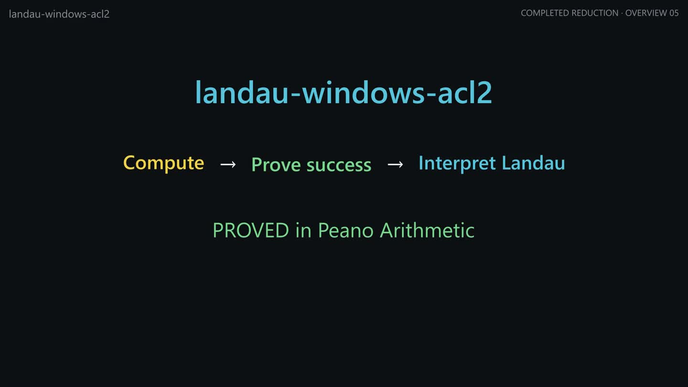

# landau-windows-acl2

<p align="center">
  <a href="https://levkropp.github.io/landau-windows-acl2/#overview">
    
  </a><br />
  <strong>The encoded windowed Landau ceiling reduction, proved in Peano Arithmetic.</strong><br />
  <a href="https://levkropp.github.io/landau-windows-acl2/#overview">Watch the completed overview</a> ·
  <a href="https://github.com/levkropp/landau-windows-acl2/releases/download/v1.0.0/landau-windows-acl2-overview-05.mp4">Download MP4</a> ·
  <a href="classical/pa-paper.pdf">Read the Peano Arithmetic proof</a><br />
  <a href="https://levkropp.github.io/landau-windows-acl2/">Follow the ten-part course and try the interactive examples</a>
</p>

**Vanilla ACL2 certifies the arithmetic windowed Landau ceiling reduction.**
The [interpretation](docs/acl2-interpretation.md) connects the encoded zeros
and rational window witnesses to the classical statement.

The Riemann Hypothesis proof architecture in
[Hart Traveller's explanation](https://github.com/harttraveller/riemann/blob/main/explanation.md)
uses Landau's theorem to turn a one-sided bound on a smoothed prime-counting
error into a zero-free region. The bound is available on recurring windows
`[Y, Y^(3/2)]`.

This project isolates that step. A zeta zero with `Re(s) > theta` forces the
ceiling `G(x) <= C x^theta` to fail on sufficiently large windows. The
effective theorem computes a rational address of a violation and certifies
the strict inequality. The [statement](docs/statement.md) defines the
statistic, hypotheses and L-function target.

## Proof status

| Layer | Result |
|---|---|
| Classical | A draft explicit certificate and search algorithm for an isolated zero. [Paper](classical/paper.pdf) · [Algorithm](classical/certificates.md) |
| Lean | Windowed Landau for zeta, both signs of `ZetaLandau` and `ZetaLandauEps`, and real-strip nonvanishing. The soft-layer audit reports `propext`, `Classical.choice` and `Quot.sound`, with zero sorries. [Lean guide](lean/README.md) |
| Arithmetic shadow | 13 choice-free theorems for interval propagation, a computed mesh and guaranteed bounded search. [Lean guide](lean/README.md) |
| ACL2 | **647 certified books and 3,649 exported theorems.** An encoded zero gives a computed threshold and a certified rational window violation. [ACL2 guide](acl2/README.md) |
| First-order PA | A direct proof of the encoded ceiling reduction, including the computed threshold and rational witness. [PA manuscript](classical/README.md#peano-arithmetic-manuscript) |

From a rational region ACL2 constructs the two circles and computes the
precision at which a small Euler sample forces a violation. The same
construction handles clustered and multiple zeros. [Main theorem](acl2/euler-window-encoded-zero.lisp) ·
[Proof ledger](docs/reduction-status.md) · [Roadmap](docs/roadmap.md)

## Why ACL2

Vanilla ACL2 certifies the exact finite computations. The TeX manuscript
proves the encoded reduction directly by coding those computations in PA.
The classical comparison identifies the encoded zeros and the returned
signal witness. [Interpretation](docs/acl2-interpretation.md)

Gödel's second incompleteness theorem helps explain the motivation. Under
its usual hypotheses, a consistent effective theory strong enough for
arithmetic cannot prove its own consistency. ZFC can prove the consistency
of PA. RH itself has arithmetic formulations, and the strength required to
prove it is open. [Foundations and sources](docs/foundations.md)

## Reference video

The original video describes the Landau step as **“A ceiling alone is
enough.”**
[Original video](https://github.com/harttraveller/riemann/blob/main/assets/full.mp4) ·
[Segment `s3_b` in the narration](https://github.com/harttraveller/riemann/blob/main/video/narration.py) ·
[Local video setup](video/README.md)

The [completed overview](https://github.com/levkropp/landau-windows-acl2/releases/download/v1.0.0/landau-windows-acl2-overview-05.mp4)
and [Parts Zero–Nine](https://levkropp.github.io/landau-windows-acl2/)
have matching captions, follow-along articles and interactive arithmetic
examples. [Release media](https://github.com/levkropp/landau-windows-acl2/releases/tag/v1.0.0)

## Build

```sh
cd lean
lake exe cache get
lake build
```

The Lean toolchain and mathlib revision are pinned. The first cache download
is large. For vanilla ACL2 setup and certification, see the
[ACL2 guide](acl2/README.md).

## Sources and credit

The windowed lemma comes from Michael Rubinstein's
[explanatory draft](https://www.math.uwaterloo.ca/~mrubinst/alpoge_claude_grh/zeta-paper.pdf)
and Levent Alpöge's Lean archive. Lifted files identify their archive paths.
[Reproducible archive verification](https://mrubinst.github.io/grh-lean-verification)

Thanks to the source authors, the mathlib and ACL2 communities, and Hart
Traveller for the reference explanation. The repository is licensed under
[MIT](LICENSE). Third-party tools retain their own licenses.
